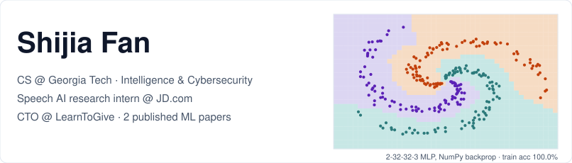
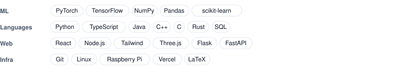
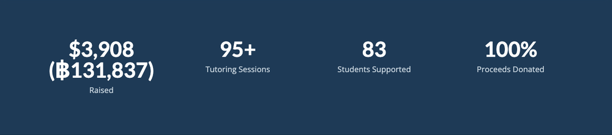
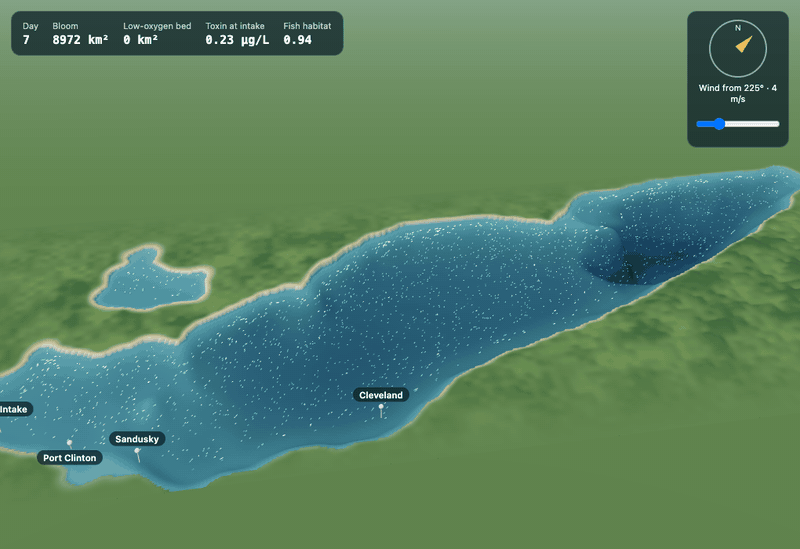
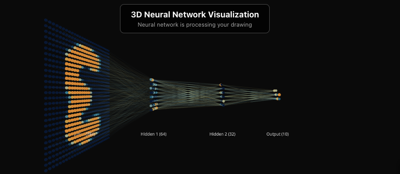

<!-- The panel is a real 2-32-32-3 MLP trained from scratch in NumPy on a spiral; the shading is
     what it predicts at each point. Regenerate every SVG here with `python make_assets.py`. -->

<picture>
  <source media="(prefers-color-scheme: dark)" srcset="assets/header-dark.svg">
  
</picture>

I build ML systems and the products around them: biosignal and speech models,
full-stack web apps, and simulations that run in the browser. CS at Georgia
Tech (May 2029).

<picture>
  <source media="(prefers-color-scheme: dark)" srcset="assets/tools-dark.svg">
  
</picture>

## &#9654;&nbsp; [LearnToGive, in production](https://learntogive.net)



<sub>The live site's impact panel. These numbers aren't typed into the page: they're fetched from a published Google Sheet, cached for 5 minutes, and fall back through stale cache to defaults if the fetch fails.</sub>

As CTO I built and shipped the whole platform: lesson booking, tutor sign-up,
donations, live impact tracking and a proxied Gemini assistant that answers
visitors' questions. React, TypeScript and Tailwind. **$3,908** raised and
**83** students supported so far, across 5 countries. [Source](https://github.com/sjfan910/ltg-website)

## &#9654;&nbsp; [A digital twin of Lake Erie, in your browser](https://superkush06.github.io/aquatic-twin/)



<sub>Recorded from the running solver. 15 simulated days of algae (0 to 60 µg/L) growing from Maumee River phosphorus on NOAA's real lakebed, depth exaggerated 600x, then the 12 depth layers pulled apart.</sub>

Transport equations for heat, phosphorus, algae, oxygen and toxin on a
**128 × 48 × 12** grid, solved live in the tab, while an operator tests cleanup
plans on copies of the solver. Built by a team of three at a 2026 Georgia Tech
hackathon. **My part:** the pipeline that turns NOAA's 22.6 MB bathymetry grid
into the solver's lakebed, and the cost model, sourced from the International
Joint Commission's study of the 2014 Toledo bloom. [Source](https://github.com/sjfan910/grokathon2026)

<picture>
  <source media="(prefers-color-scheme: dark)" srcset="assets/rule-dark.svg">
  
</picture>

## Projects

**[Multimodal emotion recognition](https://bcpublication.org/index.php/SJOHSS/article/view/9024)** &nbsp;·&nbsp; published, 2025\
A classifier that fuses facial, EEG and EOG signals, reaching **97.5%
accuracy** and beating the FDMER and MISA baselines, paired with a
Transformer-XL music generator at **1.71 perplexity**. Tested in a UK hospice.

**[Mood Creature](https://github.com/sjfan910/CNN-Sentiment-Analysis)** &nbsp;·&nbsp; a CNN on a Raspberry Pi\
A CNN trained from scratch in TensorFlow on FER2013 to **85.67% accuracy**,
then deployed to a Raspberry Pi with a camera and an OLED screen that reacts
to your face in real time.

**[3D neural network visualiser](https://github.com/sjfan910/react-MLP-visualisation)** &nbsp;·&nbsp; a forward pass you can orbit\
Draw on a 28 × 28 grid and every activation of a 784-64-32-10 MLP updates live
in WebGL, with the strongest weights drawn as edges.



<sub>A hand-drawn 3 passing through the network. The weights are Xavier-initialised to show how activations flow, not trained to classify. My trained from-scratch MLP, with NumPy backprop, reaches 92.87% on Fashion-MNIST.</sub>

**[QuantiHack '26 trading agent](https://github.com/sjfan910/marketmind-quantihack)** &nbsp;·&nbsp; finalist\
Finalist at the UK's largest quant hackathon, sponsored by Jane Street,
Optiver and Anthropic. An autonomous market maker that quotes both sides,
skews to shed inventory and widens spreads in volatile regimes, built to run
**7 days** unattended, with a FastAPI dashboard.

**EDA cognitive load prediction** &nbsp;·&nbsp; Cambridge Centre for International Research, 2025\
Predicts cognitive load from electrodermal activity on PhysioNet's n-back
data, comparing Random Forest, Gradient Boosting, MLP and SVM.

**[Boggle engine](https://github.com/sjfan910/mygamefailed6767)** &nbsp;·&nbsp; search over a 172K-word Trie\
DFS with Trie prefix pruning finds every word on the board, and a beam search
scored by word frequency powers the hint button.

<picture>
  <source media="(prefers-color-scheme: dark)" srcset="assets/rule-dark.svg">
  
</picture>

## Experience

| Role | Where | When | Result |
| :-- | :-- | :-- | :-- |
| Speech AI Research Intern | JD.com Explore Academy, Beijing | Jun to Jul 2025 | Benchmarked 5+ speech NLP models (BERT, LSTM, Bag-of-Words); **+5.53%** emotional-cue extraction from attention-mask optimisation |
| CTO | LearnToGive | Apr 2025 to now | Shipped the full platform above |
| Independent Researcher | Biosignal ML | Nov 2024 to Sep 2025 | 2 published papers |

## The numbers, and what they're measured against

| Model | Measured on | Result |
| :-- | :-- | :-- |
| Multimodal emotion classifier | Facial + EEG + EOG, against FDMER and MISA | **97.5%** accuracy |
| Transformer-XL music generator | Therapeutic music generation, from the paper | **1.71** perplexity |
| Mood Creature CNN | FER2013 | **85.67%** accuracy |
| MLP from scratch (NumPy backprop) | Fashion-MNIST | **92.87%** accuracy |
| Attention-mask optimisation (JD.com) | Elderly-care speech datasets | **+5.53%** emotional-cue extraction |

Reach me at **sjf@shijiafan.com** · [LinkedIn](https://www.linkedin.com/in/sjfan910/) · [Papers](https://www.semanticscholar.org/author/Shijia-Fan/2331773723)

---

<details>
<summary>The panel at the top isn't a drawing</summary>

<br>

`make_assets.py` trains a 2-32-32-3 MLP from scratch in NumPy on a three-arm
spiral: ReLU layers, softmax cross-entropy and a hand-written backward pass
with no autograd. The shaded cells are the class it predicts at each point of
the plane, and the dots are the training data.

```python
d3 = p.copy(); d3[np.arange(n), y] -= 1; d3 /= n
d2 = (d3 @ w3.T) * (h2 > 0)
d1 = (d2 @ w2.T) * (h1 > 0)
```

</details>
